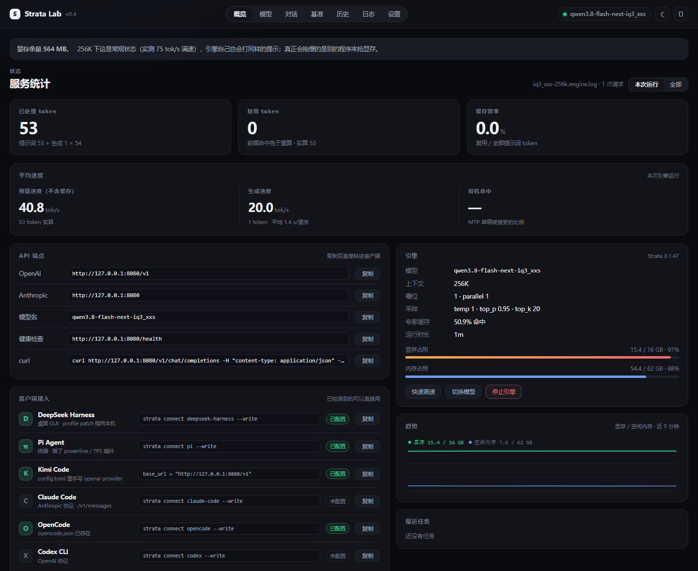
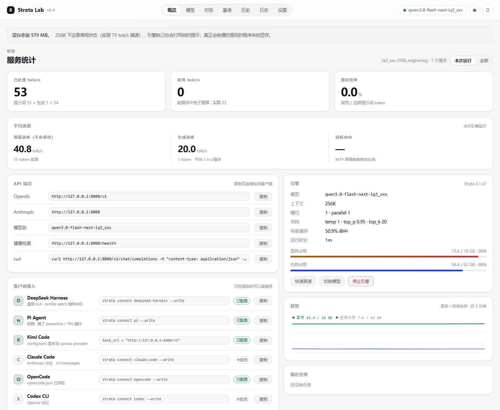

# Strata Lab v0.4

本地 Strata 推理引擎的控制台。零依赖（Python 标准库 + 单页 HTML），只监听 `127.0.0.1:8765`。

版式参考了 [oMLX](https://github.com/jundot/omlx) 的 dashboard：首屏不是一堆仪表盘，而是
**服务统计 / 平均速度 → API 端点 → 客户端接入**，把「这个服务在干什么、我怎么接进去」放在
最前面。深色是默认，右上角可切浅色（`?theme=light` 也能强制）。




## 安装与启动

需要 Windows 10+、Python ≥ 3.10，以及已安装的 Strata Terminal/Engine。模型权重不包含在本项目中。

```sh
git clone https://github.com/unistar-ai/StrataLab.git
cd StrataLab
```

把 `StrataLab` 目录放到 Strata 根目录下（与 `Strata-data`、`models`、`feed` 同级），双击 `启动_StrataLab.bat`。启动器会优先使用 `..\Strata-data\terminal\current\python\pythonw.exe`，随后拉起一个 Chromium 应用窗口指向 <http://127.0.0.1:8765>。Strata 位于其他位置时，可用环境变量 `STRATA_LAB_ROOT` 指定根目录。

想只跑服务不开窗：

```powershell
python app.py --no-open
```

**只能有一个实例**：8765 已被占用时，新实例只把窗口调到前面，不会起第二个服务。
（Windows 的 `SO_REUSEADDR` 会让第二个 socket「假绑定」成功，所以入口先用 `connect_ex` 探测。）

### 为什么它有自己的窗口

启动器不再 `start http://...` 把标签页塞进日常浏览器，而是像 ImageLab 那样拉起一个 Chromium 应用窗口：

```
msedge.exe --app=http://127.0.0.1:8765 --start-maximized
           --user-data-dir=_window_profile
           --no-first-run --no-default-browser-check
           --disable-background-timer-throttling
           --disable-backgrounding-occluded-windows
           --disable-renderer-backgrounding
           --disable-features=Translate,SleepingTabs
```

这些 Chromium 参数减少窗口被后台节流、冻结或休眠的概率；页面重新可见或获得焦点时也会立即补发一次心跳。

**窗口默认最大化**，不再传 `--window-size` / `--window-position`。`--start-maximized` 是 Chromium 的启动标志，
profile 里存过窗口几何时不一定生效，所以开窗后再用 Win32 `ShowWindow(hwnd, SW_MAXIMIZE)` 强制一次
（`logs/window.log` 里会有 `maximized hwnd=…`）。窗口宽度变化时页签会自动折行，不会消失或截断。

**不要加 `--force-device-scale-factor=1`。** 这台机器的显示器是 4K + Windows 200% 缩放：
Chromium 看到的是 1920×1040 DIP、`devicePixelRatio=2`，所以 1400×940 的窗口是 2800×1880 物理像素——
完全放得下，文字也是 2 倍大小（这正是可读的原因）。强制 scale=1 会让所有字缩一半，实测"小到看不清"，
加过一次已经回滚。真实窗口几何可以在 `GET /api/status` 的 `page` 字段里看到（页面每次心跳上报
`innerWidth/innerHeight/dpr/screen.avail*`）——用截图判断会被 DPI 虚拟化骗掉，别再用截图下结论。

- `--app=` 去掉标签栏、地址栏、工具栏，任务栏上是独立条目，可单独固定
- `--user-data-dir=` 用独立配置目录：自己的会话/窗口尺寸/缩放，和你日常浏览的窗口互不干扰
- 页面带内联 SVG favicon（黑底 S），所以标题栏和任务栏是 S 图标，而不是 Edge 的地球
- 找不到 Edge/Chrome 时退回默认浏览器（`webbrowser.open`），并在 `logs\window.log` 记一行
- 想调大小：窗口里 `Ctrl` + `+/-` 可以缩放，Chromium 会按这个 profile 记住

代价是这套窗口是一棵独立的 Chromium 进程树（约 150–300 MB 内存）。

## 十个页签

| 页签 | 内容 |
|---|---|
| **概览** | 服务统计（已处理 / 复用 token、缓存效率，可切「本次运行 / 全部」）、平均速度（预填 / 生成 / MTP 投机命中）、API 端点（一键复制）、客户端接入清单、引擎信息卡（模型 / 上下文 / 槽位 / 采样 / 显存 / 内存）、5 分钟趋势、最近任务 |
| **模型** | 档位卡片（就绪度按真实字节）、磁盘扫描（`models` 下所有 gguf 目录、大小、是否残留分片）、补分片（hf-mirror 续传，写 `*.labpart`，字节校验通过才改名） |
| **终端** | 内置真终端（Windows ConPTY + xterm.js）：cmd / PowerShell / pi / Python 四个入口，直接在里面敲命令、跑 pi 的 TUI |
| **对话** | 直接和引擎聊天：思考强度、max_tokens、系统提示；流式输出，每条显示 tok/s、tokens、首字延迟；可中途停止 |
| **基准** | 单请求测速（提示词 / tokens / 思考强度）+ 最近记录表（tok/s、tokens、首字、缓存） |
| **历史** | 启动/测速/对话/下载记录表 + decode 速度走势 + CSV 导出 + 清空 |
| **公网** | 可选 AI Gateway 的运行状态、今日/累计请求与 token、拒绝数、活动/排队请求、按 Key 筛选的审计元数据 |
| **密钥** | 注册多个命名 API Key、独立每日额度、查看每 Key 今日用量、编辑与永久删除 |
| **日志** | 引擎日志文件切换、正则过滤、跟随滚动 |
| **设置** | 接入信息、公网 Gateway 开关与默认限额、档位参数（ctx / kv / vision / parallel）、关闭方式 |

页签可以用地址栏直达：`http://127.0.0.1:8765/#models`、`#term`、`#bench`、`#logs`……

## 可选公网 AI Gateway

「设置 → 公网 API Gateway」可以启用一个轻量反向代理，供 FRP 将本地 Strata 开放为个人公网 API。
默认关闭，仍使用 Python 标准库，不需要安装新依赖。

```text
公网客户端
  → HTTPS / API Key
  → 云服务器 Caddy 或 Nginx
  → FRP 隧道
  → 本机 127.0.0.1:18080 Gateway
  → 本机 127.0.0.1:8080 Strata
```

### 启用步骤

1. 在「密钥」页填写名称，并选择每日额度为“无限”、M（百万）tokens、人民币或美元，点击「注册 API Key」。完整 Key **只在注册时返回一次**；本地 `gateway.json` 只保存 SHA-256 和 Key ID，刷新页面后无法取回完整 Key。
2. 在设置页填写公网 Base URL（例如 `https://api.example.com`）、本机端口和保护限额，点击「保存并应用」。
3. 在云服务器配置 HTTPS，并把请求反代到 FRP 暴露的 Gateway 端口。公网只开放 `443`，不要公开 StrataLab `8765`、Strata `8080` 或 FRP 管理端口。
4. 本机 `frpc.toml` 只转发 Gateway，例如：

   ```toml
   [[proxies]]
   name = "strata-gateway"
   type = "tcp"
   localIP = "127.0.0.1"
   localPort = 18080
   remotePort = 18080
   ```

   云服务器上应通过防火墙限制 `18080`，只让本机 Caddy/Nginx 访问，再经 `443` 对外服务。

公网 Base URL 只用于在页面展示接入地址；Gateway **不负责申请 TLS 证书，也不会自动修改 FRP/云服务器配置**。
Gateway 跟随 StrataLab 进程运行：退出 StrataLab 后，公网 API 也不可用。Strata 引擎本身可以独立停止或启动。

### 内置保护

- `Authorization: Bearer <Key>` 或 `X-API-Key` 鉴权；支持多个命名 Key，永久删除后立即失效，历史审计保留。
- 每个 Key 有独立每日额度。界面可选择“无限”、M tokens、人民币或美元；API 中 token 额度的 `null` 表示不限，数字 `0` 表示真实零额度。金额使用 `daily_money: {currency: CNY|USD, amount}`，`null` 表示不限，任一额度达到即拒绝请求。旧配置中代表不限的 `0` 会自动迁移为 `null`；所有额度均在“密钥”页按 Key 独立管理。
- 金额按 DeepSeek Flash 官方峰值价计算：美元输入缓存命中 $0.006/M、未命中 $0.3/M、输出 $1.2/M；人民币分别为 0.04 元/M、2 元/M、8 元/M。两种货币分别按官方报价计算，不做汇率换算。
- 只允许 `GET /v1/models`、`POST /v1/chat/completions`、`POST /v1/messages`，不代理管理 API、终端或任意路径。
- 聊天请求的 `model` 必须等于当前引擎模型，输出不能超过限额。OpenAI 同时接受 `max_tokens` 和 `max_completion_tokens`，两者都省略时应用 Gateway 上限；Anthropic 按协议要求 `max_tokens` 必填。
- 默认请求体最大 4 MiB、30 请求/分钟、单次输出最多 8192 tokens。
- 上游固定单并发；默认最多再等待 2 个请求，排队超过 30 秒或队列已满返回 429。
- 支持 OpenAI 与 Anthropic 的非流式响应和 SSE；流式响应逐行刷新，不在 Gateway 缓冲完整内容。
- 全局和每个 Key 的用量都持久化到 `gateway-state.json`，重启后不清零；旧单 Key 配置自动迁移为“主 Key”。

远程客户端的 `max_tokens` 也必须遵守限额；例如 DSH/Pi 若配置为 32768，需要在客户端调低，或在设置页提高 Gateway 上限（最高 32768）。

### 审计与隐私

「公网」页显示今日/累计请求、token、拒绝数、活动与排队请求，以及最近 100 条审计记录。可以按 API Key 筛选记录和今日统计；每条记录只有时间、Key 名称与 ID、路由、模型、状态码、耗时、输入/缓存/输出 token、DeepSeek 峰价下的人民币与美元成本，以及错误类别：

- 不记录完整 API Key，不保存提示词、消息或生成内容。
- 审计写入 `gateway-audit.jsonl`，超过 8 MiB 时轮转为一个 `.jsonl.1` 备份。
- 「清空审计与用量」会同时清空审计文件和全部计数，且不可撤销。

## 内置终端

页签「终端」是一个**真的 pty**，不是把命令跑完再贴输出：Windows ConPTY（伪控制台）+ xterm.js。
所以 `pi` 的全屏 TUI、`python -i`、带颜色的程序、方向键、Tab 补全、Ctrl+C 都正常。

结构（三段）：

```
浏览器 xterm.js  ──POST /api/term/input / GET /api/term/output──  app.py
                                                                   │  run/terminal.{out,in,ctl}
                                                                   ▼
                                                        term_host.py（独立进程）
                                                                   │  CreatePseudoConsole
                                                                   ▼
                                                        cmd.exe / pi / powershell / python
```

为什么 pty 要放在单独进程里（`term_host.py`）——三个小时的教训，都写在代码注释里：

| 坑 | 现象 | 结论 |
|---|---|---|
| `PROC_THREAD_ATTRIBUTE_PSEUDOCONSOLE` 的值 | 用宏展开算出来的 `0x00160002` 会让 `UpdateProcThreadAttribute` 返回 50 | 正确的是 **`0x00020016`**（Go 的 `x/sys/windows` 里就是这个值） |
| `CREATE_NO_WINDOW` | 加了它，shell 起来但 pty 一个字节都没有 | 不能加；子进程的“控制台”就是伪控制台，它本来没有窗口 |
| 自建环境块 | 传 `CREATE_UNICODE_ENVIRONMENT` + 手工 UTF-16 环境块，`CreateProcessW` 成功但 pty 不工作 | 改为继承环境（PATH 在 `app.py` 启动时补一次） |
| 子进程的 std 句柄 | 宿主被塞了 NUL 句柄时，cmd 把横幅和提示符写进 NUL，pty 屏幕永远是空的 | `STARTF_USESTDHANDLES` + **显式 NULL**，让 shell 回落到 `CONOUT$`（= pty） |
| 阻塞读 pty | `os.read` 把主循环卡死，键盘输入进不去 | 读放在独立线程，主循环只搬运数据 |
| xterm 回答调色板查询 | 屏幕刷满 `rgb:d0d0/4a4a/...` 垃圾 | ConPTY 不把它当“回复”，会塞给 shell 回显；前端把 `ESC ]` / DA 开头的 onData 过滤掉 |

终端会话跟着控制台走：关窗口/退出/看门狗触发时 `TERM.stop()` 会先发 `stop` 再收尾，不会留下孤儿 shell。
文件在 `run/` 下（`terminal.out/.in/.ctl/.log`），排查问题看 `run/terminal.log` 和 `run/terminal.stderr`。

**安全边界**：终端等于本机 shell。控制台只绑 `127.0.0.1` 且 POST 拒绝跨站 Origin，和直接开一个 cmd 窗口是同一权限级别；
不要把 `PORT` 改成 `0.0.0.0`。

## 服务统计是怎么来的

统计**不是**只算本页发起的请求，而是直接解析引擎日志里的每行请求总结：

```
strata serve: prompt 24 tokens = 17 reused + 7 read in 269 ms (26.0 tok/s),
              60 generated in 1050 ms (57.1 tok/s), drafts accepted 23 of 49, 1 checkpoints
```

- **已处理 token** = 提示词 token 之和（`prompt`）
- **复用 token** = 前缀命中、免于重算的部分（`reused`）；实算的是 `read`
- **缓存效率** = `reused / prompt`
- **预填速度** = `read / 预填耗时`（引擎自己的算法，已排除缓存命中）
- **生成速度** = `generated / 生成耗时`
- **投机命中** = `drafts accepted / drafts`（MTP 草稿接受率）
- **DeepSeek 等价节省**：美元 =（复用输入 × $0.006 + 未复用输入 × $0.3 + 生成输出 × $1.2）/ 1,000,000；
  人民币 =（复用输入 × 0.04 元 + 未复用输入 × 2 元 + 生成输出 × 8 元）/ 1,000,000。
  两种货币分别采用 DeepSeek Flash 的[官方美元峰值价](https://api-docs.deepseek.com/quick_start/pricing)和[官方人民币峰值价](https://api-docs.deepseek.com/zh-cn/quick_start/pricing)，**不做汇率换算**；非峰值减半。
  它表示相同 token 用量在 DeepSeek API 的估算费用，不是实际账单或净节省；不计硬件、电费、Search / Fetch 等其他费用。
- 日志按字节偏移增量读取（只读新增部分），`engine started` 行会把「本次运行」清零

因为走的是引擎日志，**DSH / pi / Kimi Code 的请求也算在里**——这正是控制台看不到别人用量时的盲点。

「实时速度」卡片则直接读取 `/metrics.live`：读取速度和生成速度同屏显示；生成时还显示平均速度、已生成 token 和耗时，预填时显示读取进度。实时卡片下方分为 Prefill 和 Decode 两张独立卡片，左右排列；折线图使用 `/metrics.history` 的最近 60 个采样点，每幅高 180px，各自使用独立纵轴，避免预填高峰把生成曲线压平。卡片每 500 ms 刷新一次，只在概览页且页面可见时轮询，离开概览或页面隐藏即暂停。实时值与上面跨请求累计的「平均速度」不是同一口径。

## 数据文件

| 文件 | 作用 |
|---|---|
| `profiles.json` | 档位参数（可被设置页改写；缺失时用内置默认） |
| `history.json` | 运行记录，最多 300 条 |
| `gateway.json` | 可选 Gateway 配置、多个命名 Key 的哈希、独立额度与启停状态；不含完整 API Key |
| `gateway-state.json` | 全局及每个 Key 的每日和累计请求/token 计数，重启后保留 |
| `gateway-audit.jsonl` | 不含消息内容的审计元数据，超过 8 MiB 轮转 |
| `logs/launch-<id>-<ts>.log` | 每次 `strata.cmd launch` 的原始输出 |
| `logs/ui.log` | 控制台自己的生命周期（启动 / 窗口出现 / 关窗退出），排查"为什么没了"看这里 |
| `logs/window.log` | 每次开窗的记录（用哪个浏览器、URL、尺寸） |
| `run/terminal.out/.in/.ctl` | 内置终端的字节流、键盘输入、控制行（resize / stop） |
| `run/terminal.log` / `terminal.stderr` | 终端宿主的日志与崩溃回溯 |
| `_window_profile/` | 应用窗口的独立 Chromium 配置（可删，会重建） |

## API

| 方法 | 路径 | 说明 |
|---|---|---|
| GET | `/api/status` | health、VRAM、RAM、profiles、任务、stale 标记、引擎指标 |
| GET | `/api/stats` | 服务计数（`run` 本次运行 / `all` 该日志全部）+ 专家缓存命中 + 上一条请求 |
| GET/POST | `/api/gateway` | 读取监控 / 更新可选 Gateway 配置；GET 支持 `?key_id=` 筛选 |
| POST | `/api/gateway/key` | 注册命名 API Key 和独立额度；完整 Key 仅本次返回 |
| POST | `/api/gateway/key/update` | 修改名称和独立额度 |
| POST | `/api/gateway/key/delete` | 永久删除 Key，保留历史审计 |
| POST | `/api/gateway/clear` | 清空 Gateway 审计和用量 |
| GET | `/api/meta` | `/props` 摘要：构建版本、模型路径、槽位、采样默认值（不返回 10 KB 的 chat template） |
| GET | `/api/live` | 当前请求状态、进度、速度、耗时及最近 60 个 Prefill/Decode 速度采样点 |
| GET | `/api/metrics` | 采样序列（每 2 秒，最多 300 点）+ 实时解析的引擎统计 |
| GET | `/api/scan` | Strata 根目录下 `models` 中的模型目录 |
| GET/POST | `/api/profiles` | 读/写档位参数 |
| GET | `/api/conn` | 端点 + 客户端接入清单（命令 + 配置是否已存在） |
| GET | `/api/logfiles` | 可用引擎日志列表 |
| GET | `/api/logs?file=&grep=` | 日志尾部（可过滤） |
| GET | `/api/history?limit=&csv=1` | 历史（CSV 导出） |
| GET | `/api/progress` | 任务列表（对话任务带已生成文本） |
| GET | `/api/term/state` | 终端状态（alive / pid / cols / rows / 累计字节） |
| GET | `/api/term/output?since=N` | 从第 N 字节起的 pty 输出（base64），`next` 是新的偏移 |
| POST | `/api/term/start` | `{kind: cmd\|pwsh\|pi\|python, cols, rows}` 起一个会话 |
| POST | `/api/term/input` | `{text}` 写进 pty（键盘输入） |
| POST | `/api/term/resize` | `{cols, rows}` 调整 pty 大小 |
| POST | `/api/term/stop` | 结束会话 |
| POST | `/api/start` | `{id, force?}` 启动档位 |
| POST | `/api/stop` | 停止引擎 |
| POST | `/api/bench` | `{prompt?, max_tokens?, effort?}` 测速 |
| POST | `/api/chat` | `{prompt, max_tokens?, effort?, system?}` 流式对话 |
| POST | `/api/cancel` | `{id}` 放弃任务 |
| POST | `/api/history/clear` | 清空 `history.json` |
| POST | `/api/quit` | `{stop_engine?}` 退出控制台（默认 `true`：连引擎一起停） |
| GET | `/api/beat` | 页面心跳（10 秒一次；窗口检测失效时的兜底：3 分钟没心跳则退出并停引擎） |
| POST | `/api/download` | `{id, limit_bytes?}` 下载缺失分片（`limit_bytes` 仅用于测试，不落盘改名） |

所有 POST 会拒绝跨站 `Origin`（403）。

## 客户端接入清单

概览页那块「客户端接入」来自 `strata connect`（Strata 自带的接入向导），逐个探测配置有没有落地：

| 客户端 | 命令 | 探测路径 |
|---|---|---|
| DeepSeek Harness | `strata connect deepseek-harness --write` | `~/.dsh` |
| Pi Agent | `strata connect pi --write` | `~/.pi/agent/models.json` |
| Kimi Code | `base_url = "http://127.0.0.1:8080/v1"`（手写） | `~/.kimi-code/config.toml` |
| Claude Code | `strata connect claude-code --write` | `~/.claude` |
| OpenCode | `strata connect opencode --write` | `~/.config/opencode/opencode.json` |
| Codex CLI | `strata connect codex --write` | `~/.codex` |

## 默认参数

`ctx=262144`（256K，本机实测可用）、`kv=k8v4`、`vision=cpu`、`parallel=1`。
每个档位独立配置，设置页改完保存即写入 `profiles.json`，下次启动生效。

## 生命周期

- **关掉窗口 = 结束整个会话**：窗口消失 **且** 没有页面心跳（两个条件同时成立）时，窗口观察器会停掉引擎并退出。实测关窗后 **约 10 秒**完成（`logs\ui.log` 会记一行原因）。
  凭什么这么判断：窗口是"有没有人在看"的直接信号，心跳是"页面是否还活着"的证据；只满足一个就杀引擎太冒险——启动瞬间窗口会闪一下，Chromium 把新 URL 转交给已有实例时也会短暂没有窗口。
- **心跳兜底**：只有 **没有 Lab 窗口、没有页面心跳、也没有任何客户端正在请求** 三者同时成立，才会停引擎并退出。窗口仍在或引擎处于 `reading/generating/queued` 时会否决退出，避免 Edge 冻结页面后误杀正常引擎；日志会记录 `heartbeat silent … keeping engine`。阈值用 `STRATA_LAB_EXIT_S=60` 调短。
- **右上角“退出”按钮**：立刻退出控制台并**停止引擎**（DSH / pi / Kimi Code 会断开），`ui.log` 会记录 `quit requested … (stop_engine=True)`。
- **设置 → 只退出控制台**：留引擎继续服务别的客户端，同样记录 `stop_engine=False`。页面“停止引擎”按钮也会写 `stop requested via /api/stop`。
- **`--no-open`（纯服务器模式）**：不弹窗、不跟随窗口，默认不安装心跳兜底；想连兜底也测，加 `STRATA_LAB_WATCHDOG=1`。
- **双击启动器时窗口已开着**：只把它提到前面，不会开第二个、也不会重启引擎。

## 已知限制

- **端口 8765 固定**（要改就改 `app.py` 里的 `PORT`）。
- **取消对话/测速只断开本端连接**：引擎可能把这一段生成完，紧接着的请求首字会变慢。
- **内置下载器只有单连接**：hf-mirror 上约 2 MB/s；大批量请用 `bench\parallel_dl.py`（6 路分段 + 校验）。
- **管理界面不做鉴权**：`8765` 只绑 127.0.0.1，别改 0.0.0.0。公网客户端应走带 API Key 的 Gateway，而不是暴露管理端口。
- 趋势图在页签不可见时停止刷新（省 CPU），切回来会立刻重画。
- **不弹黑框**：采样不 `spawn` 进程——显存由一个常驻的 `nvidia-smi --loop-ms=2000` 提供，
  进程检查改用 Toolhelp32（ctypes），`strata.cmd` / `--stop` 这类一次性调用带 `CREATE_NO_WINDOW`。
  机制：Windows 上控制台程序的父进程若**没有控制台**（`pythonw`），系统会给子进程新建 conhost + 窗口；
  有控制台（哪怕隐藏）则继承、不开窗。实测同一脚本：`python.exe` 0 个新 conhost，`pythonw.exe` 3 个。
- **引擎刚启动后的第一次请求很慢**（实测 5.1 tok/s、首字 4.6 秒），第二、三次回到 26 → 70 tok/s。
  这是专家缓存冷启动，不是配置问题。
- 统计只读**当前档位对应的那份日志**（`launch\<model>-<ctx>k.engine.log`），换档位后「全部」也跟着换。

## 横幅的两种状态

| 状态 | 触发 | 含义 |
|---|---|---|
| 黄色告警 | 检测到 ComfyUI（8188/8189 有响应） | 它会来抢显存，实测 decode 会掉到个位数 |
| 蓝色提示 | 运行中且显存余量 < 1024 MB，但没别的 GPU 程序 | **256K 下的常规状态**，实测 62–70 tok/s；不是故障 |

显存余量本身不是问题——2026-10-24 的 A/B：256K 与 224K 在同题下 decode 75.1 vs 74.5 tok/s、
预填 1549 vs 1550 tok/s，无显著差异。真正会拖慢的是外部程序抢显存。

## 许可

项目代码使用 MIT License。内置终端的 xterm.js 与 addon-fit 的第三方许可说明见
`static/THIRD_PARTY_NOTICES.md`。Strata、模型权重和 ComfyUI 不属于本项目，遵循各自许可。
